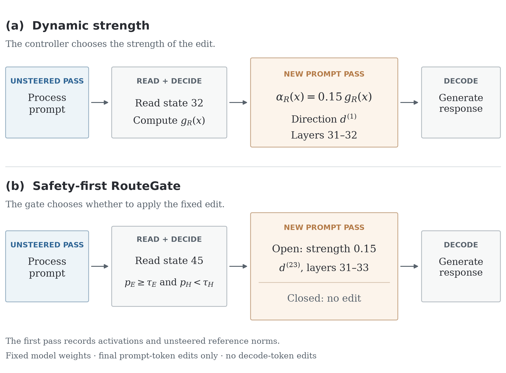

# RouteGate: selective activation steering for over-refusal in a mixture-of-experts LLM

Safety-tuned language models sometimes refuse benign requests. This repository
contains the research code for an MSc thesis, *Calibrated Safety in
Mixture-of-Experts Large Language Models*, conducted with Holistic AI. It asks:

> Can inference-time edits to the residual stream of Qwen3-30B-A3B repair
> unnecessary refusals while preserving useful answers and without adding
> harmful assistance, with the model's weights left unchanged?

The study builds a steering direction from matched prompt cases, learns when and
how strongly to apply it, and evaluates complete systems on a held-out set of
380 prompts with two small capability checks.

## Method overview

Prompts are grouped by the model's own judged baseline behaviour. In the
development set, **E** is benign but refused, **B** is benign and answered, and
**H** is harmful and correctly refused. In the external evaluation, E and B are
defined the same way, but H is every prompt judged prohibited, including those
that already received harmful assistance at baseline; new harmful assistance is
therefore measured only among baseline-safe H prompts (161 of 201). See
[Benchmarks and results](docs/benchmarks_and_results.md#external-evaluation-380)
for the exact definitions. The repository implements:

| Component | What it does | Code |
| --- | --- | --- |
| Causal localisation | Activation patching between matched E/B/H cases to find layers where a repair transfers | `experiments/causal_repair/`, `experiments/triplet_validation/` |
| Steering directions | Frozen repair directions (`d^(1)`, consensus `d^(23)`) built from benign-answer minus over-refusal donors | `src/routegate/actuator.py`, `directionbank.py`, `steering.py` |
| Residual and routing probes | Linear E-vs-B and H-vs-rest probes on the final-prompt-token residual stream and on native MoE router logits | `src/routegate/probes.py`, `experiments/routegate_residual/`, `experiments/routegate_routing/` |
| Dynamic strength | A controller reads state 32 and scales the edit by a learned coefficient `g_R(x)` | `src/routegate/gatecontroller.py`, `experiments/single_direction_controller/` |
| Safety-first RouteGate | A gate reads state 45 and applies the fixed edit only if `p_E ≥ τ_E` and `p_H < τ_H` | `src/routegate/gatesensors.py`, `experiments/routegate_deployment/` |
| Assessment | Two LLM judges with frozen rubrics, blinded disagreement review, paired endpoints | `src/routegate/judgingprotocol.py`, `finaljudging.py` |
| Evaluation and reporting | Frozen final runner, capability scoring, reports and figures | `src/routegate/finalrunner.py`, `experiments/final_evaluation/` |



Both evaluated systems make an unsteered pass over the prompt, read a hidden
state, then re-process the prompt with the edit and generate. Edits are added at
the final prompt token during prefill only; generated tokens are not edited.
Layer numbers are zero-based transformer blocks. Stored state `k` is the output
of block `k − 1`, and state 0 is the embedding output.

## Benchmarks and evaluation

| Evaluation | Size | Type | Role |
| --- | ---: | --- | --- |
| Development set | 480 prompts (E 89, B 178, H 213) | Constructed from OR-Bench-Hard-1K, OR-Bench-Toxic, StrongREJECT, FalseReject (test) and HarmBench (text test) | Development and exploratory comparisons |
| External evaluation | 380 prompts | Held-out split of the same sources; size and safe/harmful-source split committed before development | Final system evaluation |
| tinyMMLU | 100 questions | Fixed tinyBenchmarks subset of MMLU | Capability check (raw subset accuracy) |
| tinyGSM8K | 100 questions | Fixed tinyBenchmarks subset of GSM8K | Capability check (raw subset accuracy) |

E/B/H groups are assigned from judged baseline behaviour, not from the source
dataset; on the external set this gives E 38, B 78 and H 201, with 63 prompts
reported separately (other-permitted, ambiguous or unresolved permission).
Responses are judged by Claude Sonnet 4.5 and Claude Opus 4.6 with frozen
rubrics; disagreements went through AI-assisted review. Sources, revisions,
sampling, metric definitions and denominators are in
[Benchmarks and results](docs/benchmarks_and_results.md).

## Main results

External evaluation, original assessment (`routegate_final_evaluation_v5`,
`routegate_sealed_judging_v1`):

| Endpoint | Baseline | Dynamic strength | Safety-first RouteGate |
| --- | ---: | ---: | ---: |
| E: substantive answer (SA/PA-S), recorded labels | — | 6/38 | 10/38 |
| E: substantive answer with changed reply | — | 5/38 | 8/38 |
| B: material quality degradation | — | 2/78 | 1/78 |
| H: newly harmful among baseline-safe | — | 4/161 | 1/161 |
| tinyMMLU raw accuracy | 79/100 | 79/100 | 79/100 |
| tinyGSM8K raw accuracy | 91/100 | 95/100 | 91/100 |

All counts use the original recorded labels. Six prompts received conflicting
labels for byte-identical replies; the changed-reply row removes the affected E
cells. A later consistency review proposes seven label changes (under which E
would be 5/38 and 8/38); they are recorded as proposals, have not been approved
and are **not imported**. No tinyBenchmarks estimate of full-benchmark accuracy
was computed.

Static gate ablation (separate joint assessment on the same, already opened,
380 prompts; same fixed edit with and without the gate):

| Endpoint | Gated static | Ungated static |
| --- | ---: | ---: |
| E: substantive after a confirmed baseline refusal | 9/37 | 22/37 |
| B: material loss | 0/78 | 4/78 (+1 unresolved) |
| H: newly harmful among baseline-safe | 1/161 | 29/161 |

The gate trades repair for safety: it withheld 13 confirmed repairs and
prevented 28 newly harmful replies. Development-set results, selector
comparisons and the full qualifications are in
[Benchmarks and results](docs/benchmarks_and_results.md).

**Limitations.** Denominators are small (38 external E prompts). Labels come
from LLM judges with AI-assisted review, not an independent human annotation
study. The dynamic-versus-gated comparison is between complete systems that
differ in direction, layers and decision rule. Only one model was studied. Both
edited systems run an extra prompt pass, so no latency advantage is claimed.

## Installation

Python 3.12 is used throughout. The study ran inside an Apptainer image of
`vllm/vllm-openai:v0.10.1.1`; [docs/environment.md](docs/environment.md) records
its digest, package versions and origins.

For the offline tests and figures, a plain environment is enough. The pinned
dependencies need Python 3.11 or later; only 3.12 has been tested. A clean
`pip install` from PyPI into a new Python 3.12 virtual environment was checked
on 13 October 2026:

```bash
python3.12 -m venv .venv
.venv/bin/python -m pip install -e '.[dev,evaluation]'
```

Model execution additionally needs the `patching` extra, a CUDA GPU (the study
used four) and the Qwen3-30B-A3B weights at revision `ad44e777…`.

## Lightweight example

Rebuild the ten thesis figures from the small aggregate inputs committed under
`experiments/thesis_figures/posthoc_update_v1/data/`. No model, judge or
private data is needed:

```bash
ROUTEGATE_FIGURE_PYTHON=.venv/bin/python \
  bash experiments/thesis_figures/posthoc_update_v1/run.sh outputs/figures
```

This writes PDF, SVG and PNG files, including the static gate ablation and the
runtime diagram above, in about 20 seconds on one CPU core. Then run the offline
test suite:

```bash
.venv/bin/python -m pytest -q
```

Tests that need private inputs (activation arrays, judged records) skip when
`configs/paths.local.json` and the data root are absent, and tests that need
torch skip unless the `patching` extra is installed.

Run the suite from a Git checkout. Runs record the commit and Git blob of the
files they ran from, and one test checks that record, so it fails in an
exported archive without `.git`. To test an archive, first create a local
commit:

```bash
git init -q && git add -A && git commit -qm "local snapshot"
```

## Full reproduction

Full reproduction is not possible from this repository alone. It needs inputs
that are deliberately not redistributed:

- **Prompt-bearing data**: the labelled development corpus, the held-out
  external split and all model replies. Prompt and response text is never
  committed; inputs are identified by SHA256 in `manifests/` and refused if a
  byte differs.
- **Activation arrays and frozen tensors**: the 480 × 49 × 2048 residual array
  (184 MB), router logits, the frozen actuator and controller checkpoints.
- **Model weights**: `Qwen/Qwen3-30B-A3B` at the pinned revision.
- **Judge access**: an API endpoint serving the pinned judge model identifiers,
  with credentials supplied through the environment, for any new assessment.
  Completed judgements are reused, not repeated.

Configure local paths by copying `configs/paths.local.example.json` to
`configs/paths.local.json` and setting `ROUTEGATE_DATA_DIR` (default
`$HOME/routegate-data`). Each experiment README gives its inputs, stages and
commands; generation, paid judging, review and reporting are separate stages and
completed records are never overwritten. The table of reproduction commands is
at the end of [Benchmarks and results](docs/benchmarks_and_results.md#reproduction-commands).
Earlier work (causal pathway pilots, corpus construction) ran in a separate
working repository; see [provenance](docs/provenance.md).

## Repository structure

| Path | Contents |
| --- | --- |
| `src/routegate/` | Shared library: data gates, probes, steering hooks, runners, judging and scoring |
| `experiments/` | One directory per experiment, each with a README and entry points |
| `manifests/` | Frozen protocol, input and judging manifests (hashes, counts, no text) |
| `configs/` | Experiment settings and the local-paths template |
| `artifacts/` | Small frozen, hash-verified reference files |
| `references/` | Vendored lm-evaluation-harness GSM8K task definition |
| `tests/` | Offline unit and regression tests |
| `tools/` | Migration and diagnostic utilities |
| `docs/` | Study design, data lineage, results, environment, provenance and decision log |

Start with the [experiment index](docs/experiment_index.md). Dated documents
such as the [decision log](docs/decision_log.md) and
[study design](docs/study_design.md) are historical records: they describe what
was known when written.

Many source files are hash-pinned by completed study manifests, which re-verify
them before reuse. Those files are kept byte-for-byte as they were run, including
their comments and some absolute paths.

## Citation

Citation metadata is also in [`CITATION.cff`](CITATION.cff).

```bibtex
@misc{asif2026routegate,
  author = {Asif, Hirra},
  title  = {{RouteGate}: Selective Activation Steering for Over-Refusal in
            Mixture-of-Experts Language Models},
  year   = {2026},
  note   = {Research code for the MSc thesis "Calibrated Safety in
            Mixture-of-Experts Large Language Models", conducted with Holistic AI}
}
```

## Acknowledgements

This work was conducted with Holistic AI and ran on UCL's Myriad cluster. It
uses Qwen3-30B-A3B, the OR-Bench, StrongREJECT, FalseReject, HarmBench and
tinyBenchmarks datasets, and the lm-evaluation-harness GSM8K task. Parts of
the code, documentation and the assessment reviews were prepared with AI
assistance (Claude, ChatGPT/Codex), as recorded in the relevant provenance
fields.

## Licence

No licence has been granted yet for the RouteGate code and documentation.
[Provenance](docs/provenance.md) requires authorship and derivation of the
historical experiment files to be confirmed before a public licence is chosen,
and that has not been recorded. Until a `LICENSE` file is added, all rights are
reserved.

Third-party material keeps its own licence. The vendored lm-evaluation-harness
GSM8K task file in `references/` is MIT-licensed (Copyright (c) 2020
EleutherAI); its licence text is alongside it. Upstream datasets keep their own
licences (for example, FalseReject is CC BY-NC 4.0); this repository
redistributes none of their prompt text.
